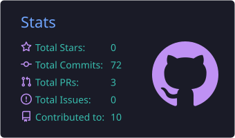
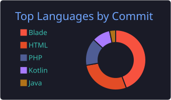

<!-- Header bergelombang animasi -->

<!-- Teks mengetik animasi -->

  

## 👋 Tentang Saya
- 🔭 Sedang mengerjakan: **Eightracer**
- 🌱 Sedang belajar: **Kotlin**
- 💬 Tanya saya tentang: **Backend!**
- 📫 Kontak: **ismailtegar1@student.ub.ac.id**

## 🛠️ Tech Stack

  

## 📊 Statistik GitHub

  
  

## 🐍 Grafik Kontribusi

<!-- Footer bergelombang -->

